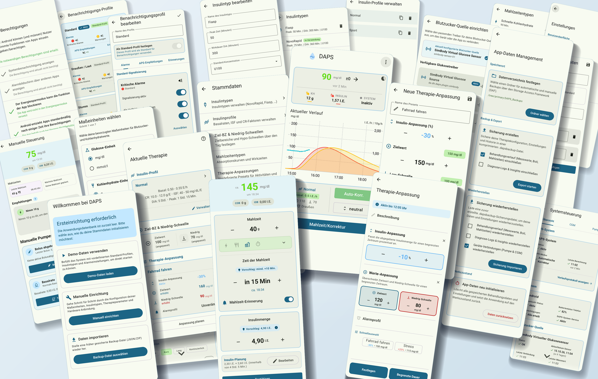
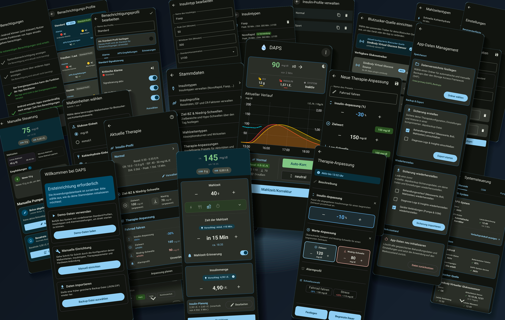

# DAPS — For everyone who wants maximum control and fun with diabetes management

[[Deutsche Version]](#deutsch) • [](https://discord.gg/d3KPpgJ5f)

## 💡 Current state
I'm currently testing the app by myself since November, 6th with the integrated Dana-i driver. The app works really, really fine with the Dana i driver.
The Omnipod Dash driver is not tested yet and seems to have Bluetooth problems. Unfortunately, I don't have a test device present. Help is welcome. 

The app can also be tested with the Sim-Body plugin. Just compile in simDebug flavor.

> [!WARNING]
> **Experimental software — not a medical device.**
>
> DAPS is under active development and is open-source software. Use it at your own risk.
Do not rely exclusively on this app for medical decisions or insulin dosing.
Always verify medical decisions using your manufacturers' official devices as well as official documentation.

---

## 💡 DAPS – Daniel's APS
DAPS is an AID system, i.e., an insulin pump controller with CGM support. There are several of these, but DAPS is made for those who want full control over their insulin therapy. It is easy to use and self-explanatory, yet gives you all the information and intervention options that are missing in official systems.
It is a system by a diabetic – for diabetics – for you. I believe that diabetes therapy can actually be fun if you have a tool at hand that accompanies you and offers key functions simply when you need them – instead of working against you.

Some screenshots:


And in dark theme:


DAPS is right for you if:
- You are looking for a tool that provides exactly the features you need for everyday life right where you need them
- You know your way around your diabetes and know what you're doing
- You repeatedly feel "I could have handled this situation better myself", but your AID system doesn't really let you
- You like to eat pizza, but your AID system is not flexible enough to plan insulin delivery for it
- You've ever forgotten a meal or ate less, more, or differently than planned, and your AID system stubbornly delivers the original insulin plan without letting you stop or change it afterwards
- You are also annoyed that your AID system keeps beeping wildly even though you've long known you are in the low range – but the beeping simply can't be muted
- Your AID system only provides very limited options to temporarily adjust the insulin dosage (e.g., during sports, illness, temperature fluctuations, or stress)
- You frequently want to switch between different situations (sport – office – etc.)
- You need a replacement for the DBLG1 with the Dana i pump with Dexcom
- You are looking for a beautiful UI :-)

## ✨ What can DAPS do?
DAPS does the "normal stuff" really well (blood glucose display, Manual Mode ("Open Loop"), Automatic Mode ("Closed Loop"), bolus calculator with various recommendations, standard insulin and profile settings, ...). In addition, DAPS can, for example:
- Define personal and switchable alarm profiles (e.g., Office, Cinema, Home, Night, ...)
- Seamlessly switch between Auto and Manual Mode. E.g., if you want manual control for a while (sport, driving – or because blood sugar is going crazy, ...) and then seamlessly go back to autopilot
- "Multi-course meals"/Buffet – Multi-stage, overlapping insulin deliveries that remain viewable and even editable afterwards
- Quickly switch target values, low thresholds, percentage insulin adjustment, alarm profiles, and insulin profiles, including timer-based switching
- Set individual meal types with custom action curves including quick selection of meal types when logging a meal
- Naturally supports mg/dL and mmol/L, KE (carb units) or grams of carbs, setting insulin concentration (U100, U200, ...), setting insulin duration and action curves, setting hourly basal rates and insulin factors throughout the day
- Integration of native CGM and pump drivers. As of October 2026, xDrip as a glucose source and the Dana-i and Omnipod Dash pumps are already supported. More CGMs and pumps will follow.

### 🔮 Planned for the future:
- Improved support for visually impaired users
- Simple mode / Kids mode
- Food database, perhaps with KI support
- Additional CGM and pump drivers

## ⚖️ Comparison with AAPS
### General
The large open-source project AAPS is very powerful and can do just about anything you can imagine.
DAPS, on the other hand, is more streamlined and provides key features for everyday life exactly where you need them.
### Extensive differences in data model and handling
For example, we have a different way of handling the insulin profile. We also store basal, ISF, and IC values there,
but target and low blood glucose thresholds are stored separately. The profile relates to the body state and changes with it. Target and
low values, however, are a self-set goal depending on the situation. Therefore, we separate the insulin action profile from the
definition of blood glucose target values. For DAPS, a single insulin action profile is usually sufficient (or perhaps one additional profile for multi-day
hikes or summer when insulin acts differently due to temperature). All other
temporary fluctuations (sports, illness, stress, ...) are simply adjusted as an insulin adjustment factor via quick settings,
just like other temporary adjustments (target values, notification profile), and can be saved together as a quick setting, retrieved, and scheduled (cycling, work, night, discreet, ...).
This is just one example of a small but important difference that makes daily handling easier.
### New calculation algorithm
The actual calculation algorithm was also developed from scratch and is significantly more lightweight
yet powerful. It is optimized for both memory and computation time and is based on a prediction model that
takes blood glucose trends, ingested food, and insulin doses into account.
### Plugin interface
Like AAPS, we have an interface for insulin pump plugins. Additionally, we have an interface for direct integration
of the CGM driver so that no additional apps will be required in the future. Currently, however, we only have the standard interface to xDrip or
Juggluco in the app, so at the moment we still rely on xDrip or Juggluco to provide the values.

## 🚫 What is DAPS not / what can't it do?
It is not quite finished yet, but getting there step by step. It is currently in the beta phase. However, it will not turn into an all-in-one bloated
monster; decisions are also made against certain features. You do, however, have the opportunity to influence these decisions to a limited extent –
feel free to drop by my [Discord Server](https://discord.gg/d3KPpgJ5f).
The set of supported plugins is currently limited to the CGM receiver plugin (receiving values via xDrip or Juggluco)
and the driver for the Dana-i pump. The Omnipod Dash driver is not finished yet. Reporting features to Nightscout etc. are also not yet
implemented.

## ⭐ Please......
Leave a star for this project to show me that you like it. You wouldn't believe how much work goes into making a system feel "polished" and enjoyable to use. And it's immensely encouraging when people like it. There is also a donation button on the side, but that's completely optional.

## 🚀 Trying it out
DAPS is completely open source and can be compiled with a current version of Android Studio.
You will need a modern Android smartphone (e.g., Samsung Galaxy S26) and ideally a CGM and a supported insulin pump. You can also use the body simulator with a simulated CGM and simulated insulin pump for testing purposes.
DAPS is modularly structured and is built with different modules depending on requirements. Switching between different variants is handled via build flavors.

### 🛠️ Quickstart

1. Clone repository:
   ```bash
   git clone https://github.com/Albert78/DAPS.git
   ```
2. Open project in **Android Studio**.
3. Run directly on your Android smartphone (use the `simDebug` flavor for the integrated body simulator!).

*Note: Major updates may require clearing local app data (App Info ➔ Storage ➔ Clear Data).*

### 🧪 Trying it "for real"
... is something I currently advise against. The system is almost ready, but still in the alpha phase and could make mistakes. If you still want to test it, compile one of the `prod` build flavors. A minimum set of drivers is already available to connect to e.g. xDrip and the Dana-i pump.

### 🧪 Integrated Body Simulator (`sim-body`)
You can test the app, its calculation algorithm, meals, insulin delivery, and look & feel safely without hardware! Simply build the app in a `sim` build flavor and simulate glucose curves, sports, or stress directly on your phone.

### 🧱 Tech Stack
* **Language:** Kotlin
* **UI & Navigation:** Jetpack Compose & Navigation 3
* **Reactivity:** Kotlin Coroutines & Flow
* **Persistence:** Room Database
* **Background:** Optimized Android Foreground Services

### 🌐 UI & Localization
The user interface is currently only localized in German and is optimized for the Samsung Galaxy S26.

---

## 📄 License

This project is licensed under the [MIT License](LICENSE).

---

<a id="deutsch"></a>
# Deutsche Version
# DAPS - Für alle, die maximale Kontrolle und Spaß beim Diabetes-Management haben wollen

[](https://discord.gg/d3KPpgJ5f)

> [!WARNING]
> **Experimentelle Software — kein Medizinprodukt.**
>
> DAPS befindet sich in aktiver Entwicklung und ist eine Open-Source-Software. Die Nutzung erfolgt auf eigene Gefahr.
Verlasse dich nicht ausschließlich auf diese App für medizinische Entscheidungen oder Insulindosierungen.
Überprüfe wichtige medizinische Entscheidungen stets mit den offiziellen Geräten der Hersteller sowie nach den
offiziellen Dokumentationen.

---

## 💡 DAPS – Daniels APS
DAPS ist ein AID-System, also ein Insulinpumpen-Controller mit Unterstützung eines CGM-Systems. Davon gibt es einige, aber DAPS ist für diejenigen gemacht, die die volle Kontrolle über ihre Insulin-Therapie haben wollen. Es ist einfach zu verwenden und selbsterklärend und gibt einem doch alle Informationen und Eingriffmöglichkeiten, die man bei den offiziellen Systemen vermisst.
Es ist ein System von einem Diabetiker – für Diabetiker – für dich. Ich bin der Meinung, dass die Diabetes-Therapie auch Spaß machen kann, wenn du ein Tool zur Hand hast, das dich begleitet und dir die wichtigen Funktionen einfach anbietet, wenn du sie brauchst – statt gegen dich zu arbeiten.

Einige Screenshots:


Und im dunklen Theme:


DAPS ist das richtige für dich, wenn
- Du ein Tool suchst, das für den Alltag genau die Funktionen dort bereithält, wo man sie braucht
- Du dich auskennst mit deinem Diabetes und weißt, was du tust
- Du immer wieder den Eindruck hast, „Diese Situation hätte ich jetzt selbst besser hinbekommen“, dein AID-System lässt dich aber nicht so richtig
- Du gerne mal eine Pizza isst, dein AID-System aber nicht flexibel genug ist, die Insulingaben dafür zu planen
- Du schon mal eine Mahlzeit vergessen hast oder weniger oder mehr oder anders gegessen hast als geplant und dein AID-System den ursprünglichen Insulinplan stumpf abgibt, ohne dass du es nachträglich stoppen oder ändern kannst
- Dich auch nervt, dass dein AID-System wild rumpiept, obwohl du längst weißt, dass du im Niedrigbereich bist – das Piepen aber einfach nicht
  stummgeschaltet werden kann
- Dein AID-System nur sehr eingeschränkt die Insulindosis temporär anpassen kann (z.B. bei Sport, Krankheit, Temperaturschwankungen oder bei Stress)
- Du öfter zwischen verschiedenen Situationen wechseln möchtest (Sport – Büro – etc.)
- Du einen Ersatz für den DBLG1 mit der Dana i pumpe und dem Dexcom-System brauchst
- Du eine wunderschöne UI suchst :-)

## ✨ Was kann DAPS?
Das „normale Zeug“ kann DAPS wirklich gut (Blutzuckerwert-Anzeige, Manueller Modus („Open Loop“), Automatischer Modus („Closed Loop“),
Bolusrechner mit diversen Empfehlungen, die üblichen Insulin- und Profileinstellungen, ...). Zusätzlich kann DAPS z.B.:
- Definition von persönlichen und umschaltbaren Alarm-Profilen (z.B. Büro, Kino, Zuhause, Nachts, ...)
- Nahtloses Umschalten zwischen Auto- und Manuellem Modus. Z.B. wenn man doch mal eine Zeit lang die manuelle Kontrolle haben will (Sport, Autofahrt – oder weil der Blutzucker gerade verrückt spielt, ...) und dann aber wieder nahtlos auf Auto-Pilot gehen will
- „Etappenessen“/Buffet – Mehrstufige, überlappende Insulingaben, und zwar auch noch nachträglich einsehbar und sogar änderbar
- Schnelles Umschalten von Zielwert, Niedrig-Schwellwert, prozentualer Insulin-Anpassung, Alarm-Profil und Insulin-Profil, auch zeitgesteuert
- Einstellung individueller Mahlzeitentypen mit individuellen Wirkkurven incl. Schnellauswahl der Mahlzeittypen bei der Eingabe einer Mahlzeit
- Natürlich geht Einstellung mg/dl und mmol/l, KE oder g Kohlenhydrate, Einstellung der Insulinkonzentration (U100, U200, ...), Einstellung der Insulin-Wirkkurve und -Dauer, Einstellung der stündlichen Basalraten und Insulinfaktoren über den Tag
- Integration von nativen CGM- und Pumpentreibern. Stand Oktober 2026 werden schon xDrip als Blutzuckerwert-Quelle und die Dana-i- und Omnipod Dash-Pumpen unterstützt. Weitere CGMs und Pumpen werden folgen.

### 🔮 Perspektivisch sind angedacht:
- Verbesserte Unterstützung für Sehbehinderte
- Einfacher Modus / Kindermodus
- Nahrungsdatenbank
- Weitere CGM- und Pumpentreiber

## ⚖️ Vergleich mit AAPS
### Allgemein
Das große Open-Source-Projekt AAPS ist sehr leistungsstark und kann so gut wie alles, was man sich vorstellen kann.
DAPS hingegen ist übersichtlicher und bietet wichtige Funktionen für den Alltag genau dort, wo man sie braucht.
### Umfangreiche Unterschiede im Datenmodell und Umgang
Zum Beispiel haben wir eine andere Art, mit dem Insulinprofil umzugehen. Wir speichern auch die Basal-, ISF- IC-Werte dort ab,
Ziel- und Niedrigwert legen wir aber separat davon ab. Das Profil hat Bezug zum Körperzustand und ändert sich mit ihm. Ziel- und
Niedrigwert sind aber eine selbstgesteckte Zielgröße, die von der Situation abhängt. Daher trennen wir Insulin-Wirkprofil und die
Festlegung der Blutzucker-Werte. Für DAPS genügt daher ein einziges Insulin-Wirkprofil (oder vielleicht noch eins für tagelange
Wanderungen oder für den Sommer, wenn das Insulin aufgrund der Temperatur anders wirkt). Alle anderen
temporären Schwankungen (Sport, Krankheit, Stress, ...) werden einfach über die Schnelleinstellungen als Insulin-Anpassungsfaktor
eingestellt, genau wie andere temporäre Anpassungen (Zielwerte, Benachrichtigungsprofil) und können als Schnelleinstellung
gemeinsam gespeichert, abgerufen und zeitlich geplant werden (Fahrradfahren, Arbeit, Nacht, Diskret, ...).
Das ist nur ein Beispiel für eine kleine, aber wichtige Abweichung, die den täglichen Umgang erleichtert.
### Neuer Berechnungsalgorithmus
Auch der eigentliche Berechnungsalgorithmus wurde von Grund auf neu entwickelt und ist wesentlich leichtgewichtiger
und trotzdem leistungsfähig. Er ist sowohl Speicher- als auch Rechenzeit-optimiert und basiert auf einem Vorhersagemodell, das
den Blutzuckerverlauf, die eingenommene Nahrung und die Insulingaben berücksichtigt.
### Plugin-Schnittstelle
Wir haben wie auch AAPS eine Schnittstelle für Insulinpumpen-Plugins. Außerdem haben wir eine Schnittstelle für eine direkte Integration
des CGM-Treibers, so dass man später keine weiteren Apps benötigen wird. Aktuell haben wir aber nur die Standardschnittstelle zu xDrip oder
Juggluco in der App, so dass wir im Moment noch darauf angewiesen sind, dass xDrip oder Juggluco die Werte liefern.

## 🚫 Was ist/kann DAPS nicht?
Es ist noch nicht ganz fertig, wird aber Schritt für Schritt fertiger. Es befindet sich noch in der Beta-Phase. Es wird sich aber nicht zur
eierlegenden Wollmilchsau entwickeln, es werden auch Entscheidungen gegen bestimmte Features getroffen. Du hast allerdings die Möglichkeit,
diese Entscheidungen begrenzt zu beeinflussen – schau einfach auf meinem [Discord-Server](https://discord.gg/d3KPpgJ5f) vorbei.
Die Menge der unterstützten Plugins ist im Moment noch beschränkt auf das CGM-Receiver-Plugin (Werte per xDrip oder Juggluco empfangen)
und den Treiber für die Dana i Pumpe. Der Omnipod Dash ist noch nicht fertig. Auch Reporting-Funktionen an Nightscout etc. sind noch nicht
implementiert.

## ⭐ Bitte......
Lass einen Stern für dieses Projekt da, um mir zu zeigen, dass es dir gefällt. Du glaubst nicht, wie viel Arbeit es macht, ein System „rund“ zu machen,
dass es einfach nur gefällt. Ich sitze viele Stunden meiner Freizeit an dem Projekt und stelle es zur Verfügung.
Und es spornt enorm an, wenn es Leuten gefällt.
Wenn du das Projekt unterstützen möchtest, findest du rechts auch einen Spendenknopf – das ist aber natürlich völlig freiwillig.

## 🚀 Es ausprobieren
DAPS ist vollständig Open Source und kann mit einer aktuellen Version von Android Studio compiliert werden.
Du benötigst ein aktuelles Android Smartphone (z.B. Samsung Galaxy S26) und bestenfalls ein CGM und eine unterstützte
Insulin-Pumpe. Du kannst zum Ausprobieren aber auch den Körper-Simulator mit simuliertem CGM und simulierter
Insulin-Pumpe nutzen.
DAPS ist modular aufgebaut und wird je nach Anforderung mit verschiedenen Modulen gebaut. Zwischen den verschiedenen
Varianten wird über Build-Flavors umgeschaltet.

### 🛠️ Quickstart

1. Repository klonen:
   ```bash
   git clone https://github.com/Albert78/DAPS.git
   ```
2. Projekt in **Android Studio** öffnen.
3. Direkt auf deinem Android-Smartphone ausführen (`simDebug`-Flavor für den integrierten Körper-Simulator nutzen!).

*Hinweis: Bei großen Updates kann ein Löschen der lokalen App-Daten erforderlich sein (App-Info ➔ Speicher ➔ Daten löschen).*

### 🧪 Es "richtig" ausprobieren
... rate ich im Moment noch von ab. Das System ist fast so weit, befindet sich aber noch in der Alpha-Phase und
kann Fehler machen. Willst du es dennoch testen, compiliere einen der `prod`-Build-Flavors. Es ist schon ein
Minimum an Treibern vorhanden, um sich z.B. mit xDrip und der Dana-i-Pumpe zu verbinden.

### 🧪 Integrierter Körper-Simulator (`sim-body`)
Du kannst die App, ihren Berechnungsalgorithmus, Mahlzeiten, Insulingaben und das Look&Feel gefahrlos ohne Hardware testen!
Bau einfach die App in einer `sim`-Build-Flavor und simuliere Glukoseverläufe, Sport oder Stress direkt auf dem Handy.

### 🧱 Tech Stack
* **Sprache:** Kotlin
* **UI & Navigation:** Jetpack Compose & Navigation 3
* **Reaktivität:** Kotlin Coroutines & Flow
* **Persistenz:** Room Database
* **Hintergrund:** Optimierte Android Foreground Services

### 🌐 Hinweis zu UI & Lokalisierung
Die Benutzeroberfläche ist aktuell nur auf Deutsch lokalisiert und auf das Samsung Galaxy S26 optimiert.

---

## 📄 Lizenz

Dieses Projekt steht unter der [MIT-Lizenz](LICENSE).